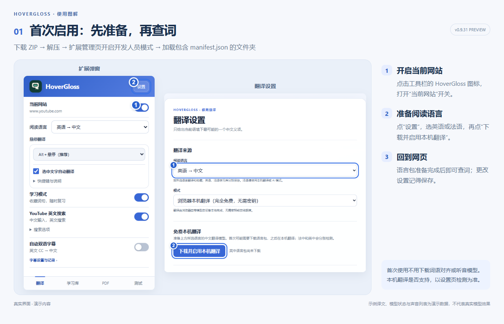
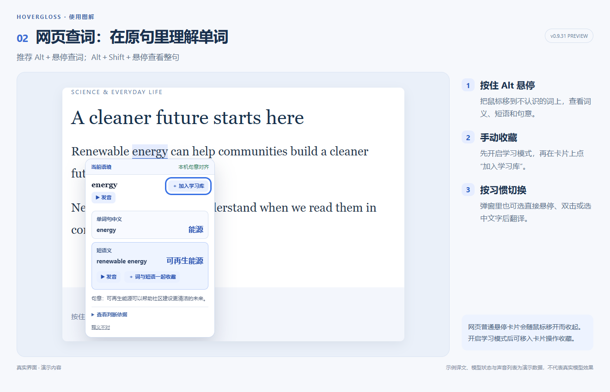
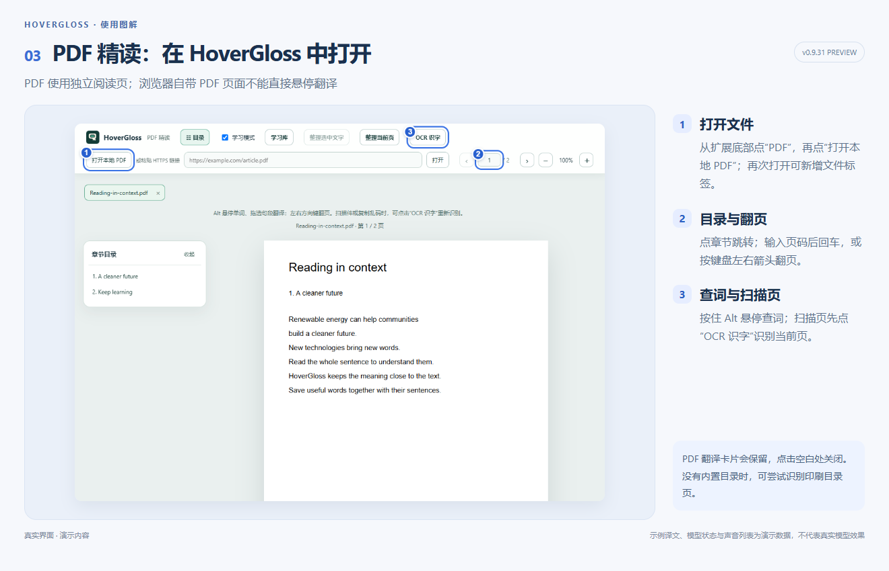
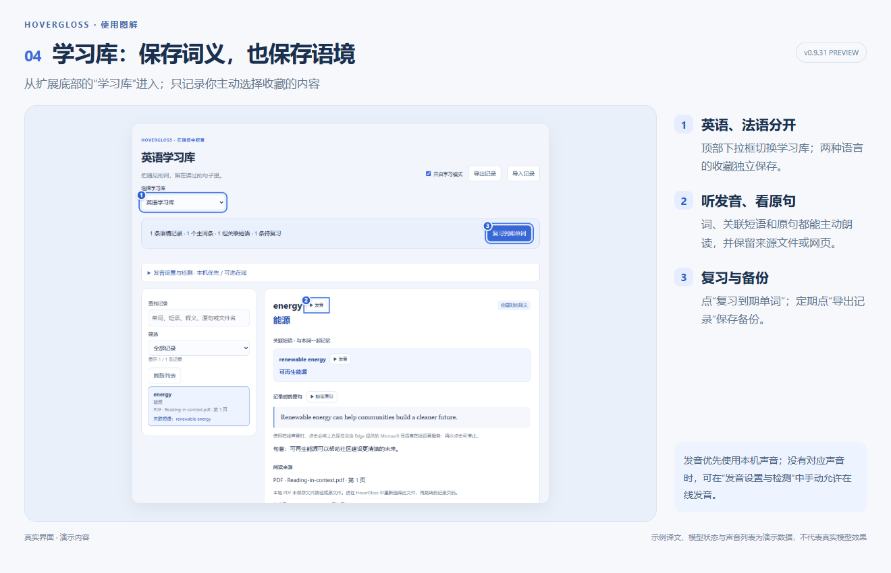
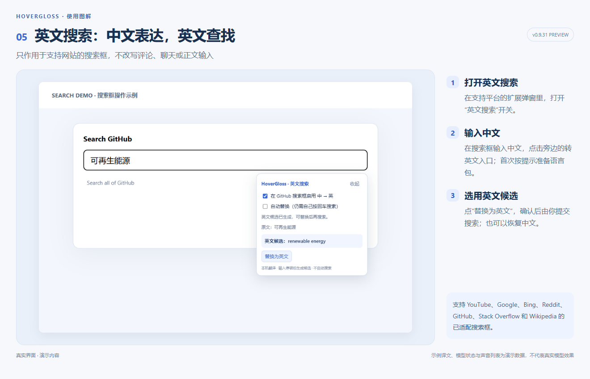
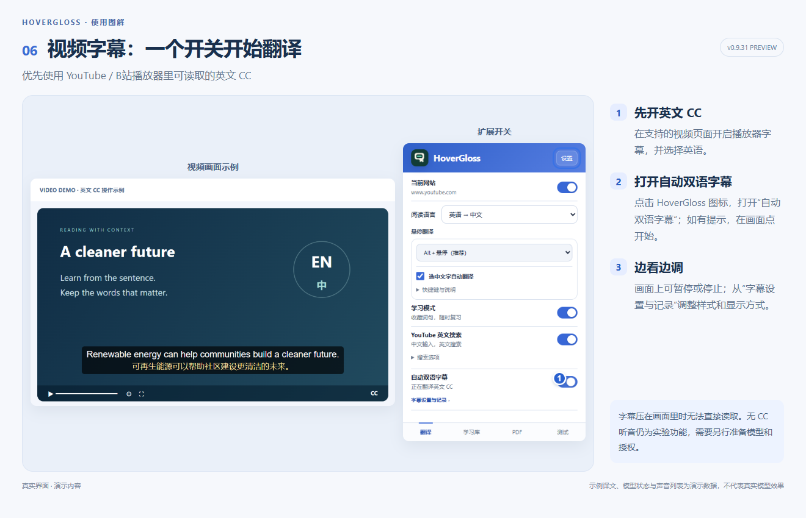

# HoverGloss · 极简悬译

**在阅读的位置理解词句。** 面向英语、法语阅读的 Chrome / Edge 扩展：悬停查词、PDF 精读、语境学习库，以及可选的双语字幕。

**[下载扩展安装包（v0.9.31 Preview）](https://github.com/j9919182-beep/HoverGloss/releases/download/v0.9.31-preview/HoverGloss-v0.9.31-preview.zip)** · [发布说明与其他附件](https://github.com/j9919182-beep/HoverGloss/releases/tag/v0.9.31-preview)

[English](README.en.md) · [安装与首次使用](docs/INSTALL.md) · [隐私说明](PRIVACY.md) · [更新日志](CHANGELOG.md)

> 当前为 **v0.9.31 Preview**，尚未上架浏览器扩展商店。翻译、词语对齐和字幕结果可能有误，请结合原文核对。

## 能做什么

- **网页词句翻译**：默认 Alt＋悬停查词，Alt＋Shift 查看整句；也可选中文字翻译。英语、法语手动切换。
- **PDF 精读**：本地文件或 HTTPS PDF；多文件标签、页码跳转、目录识别、续读位置。尝试补全跨页句子；扫描页可手动 OCR。
- **独立学习库**：英语、法语分开保存词义、关联短语、原句和来源；支持发音、笔记、复习与 JSON 导入导出。法语提供离线基础语法提示。
- **英文搜索辅助**：在支持平台的搜索框，把中文转成英文；搜索仍由你提交。
- **可选双语字幕**：支持 YouTube / B站可读取的英文 CC，开关控制本机英中翻译。无 CC 的 YouTube 听音识别仍是实验功能，需独立授权。

## 图解上手

点击图片可放大。图片来自当前版本的真实界面；文档、译文、模型状态和声音列表为演示数据，用于说明操作，不代表真实模型效果。

### 1. 首次启用

### 2. 网页查词与收藏

### 3. PDF 阅读与 OCR

### 4. 英语与法语学习库

### 5. 中文转英文搜索

### 6. 视频双语字幕

## 开始使用

1. [下载扩展安装包](https://github.com/j9919182-beep/HoverGloss/releases/download/v0.9.31-preview/HoverGloss-v0.9.31-preview.zip)并解压；源码和校验文件见 [Release 发布页](https://github.com/j9919182-beep/HoverGloss/releases/tag/v0.9.31-preview)。
2. 打开 `edge://extensions` 或 `chrome://extensions`，开启开发人员模式，点击“加载解压缩的扩展”。
3. 选择直接包含 `manifest.json` 的文件夹。安装即用，不需要 Node.js 或自行构建。
4. 打开 HoverGloss 设置，选择阅读语言，主动准备本机翻译；再在网页弹窗中开启“当前网站”。
5. 按住 **Alt** 悬停单词。完整步骤和常见问题见[安装说明](docs/INSTALL.md)。

本机翻译取决于浏览器提供的 Translator API、语言对和设备支持；版本号并不是可用保证。Chrome 官方列出的 API 支持起点为 Chrome 138 / Edge 148 桌面版，首次可能下载语言包，实际以设置页检测为准。[官方说明](https://developer.chrome.com/docs/ai/translator-api)

本机模式无需 API 密钥；自备 AI 接口、在线声音可能产生服务商费用或限制。未配置 AI 时，默认智能模式使用本机翻译。首次使用不用准备对齐或听音模型。

## 使用边界

- 原生浏览器 PDF 阅读器中不能直接悬停；请在 HoverGloss PDF 阅读页打开。复杂分栏、跨页拼接、OCR 可能取文不完整或出错。
- 单词机译、短语整体译义与已确认句中义会分开标注；匹配线索不是准确率，本机对齐不保证改善每个词。
- 字幕依赖可读取的英文 CC；压进画面里的字不能直接读取。YouTube Shorts、B站直播/番剧及画中画暂不支持；后台字幕可能延迟。
- 法语语法提示是规则型入门辅助，不是完整句法分析。完整 AI 解析需手动调用自备接口。
- 每种语言学习库最多 1000 条语境记录、6 MiB；保存在当前浏览器，不跨设备同步。卸载前请导出。
- 本项目的自动测试包含模拟模型/字幕；不代表所有网站、真实翻译模型和设备均已验证。

## 数据与权限

本机翻译和 OCR 在设备处理；自备 AI 会接收你翻译的文本/语境，在线发音会接收主动朗读的文字。模型下载会访问相应模型提供方。学习记录只在手动收藏后保存。

强制权限为 `storage`、`activeTab`、`offscreen`、`sidePanel`；`tabCapture` 为可选权限，只用于主动开启的听音模式。扩展目前具有广泛的 HTTPS 主机权限。详情见[隐私说明](PRIVACY.md)及[清单](manifest.json)。

## 反馈与参与

遇到问题请通过本仓库 Issues 提交浏览器版本、扩展版本、复现步骤、期望结果与实际结果。使用脱敏句子或自己有权分享的样例；不要上传密钥、学习库原始备份或私人 PDF。

[贡献说明](CONTRIBUTING.md) · [安全问题反馈](SECURITY.md) · [开发与定向测试](TESTING.md)

## 许可证

HoverGloss 自有代码和图标采用 [MIT](LICENSE)。PDF.js、字体、OCR、模型运行库及按需下载的模型分别遵循上游许可，见[第三方清单](THIRD_PARTY_NOTICES.md)。
